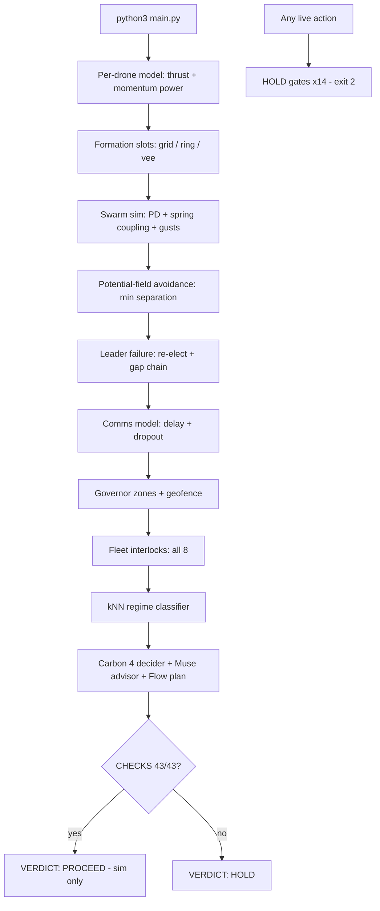
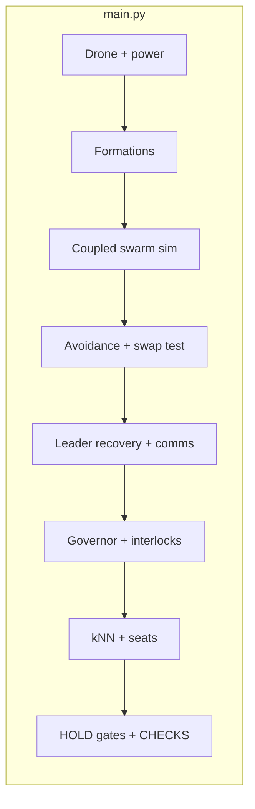
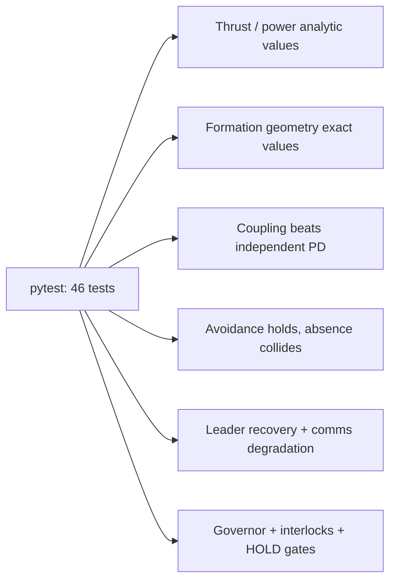
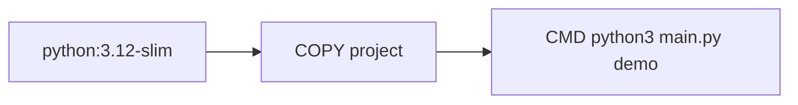

# 🐝 DroneHover-Swarm — Hover Drone Swarm Coordination Lab

> **A SIM-ONLY drone swarm coordination lab in pure Python stdlib: 25 hover drones in grid / ring / V formations, spring-damper neighbour coupling, potential-field collision avoidance, leader-failure recovery, a comms delay/dropout model, a swarm governor + geofence, fleet pre-flight interlocks, and 14 HOLD gates. Nothing here flies anything real.**
>
> 👨‍💻 By Darion Kellar · 📜 MIT License · 🐍 Pure stdlib · 🌐 Zero network

---

## ❓ What is this about?

HoverX asked: *can one hover vehicle hold itself up, hold its attitude, and hold its limits — in simulation?* DroneHover-Swarm asks the harder question: *can twenty-five of them do it together?*

| Lab | Question |
|---|---|
| 🛸 HoverX | One vehicle: thrust, ground effect, PID, governor, interlocks |
| 🐝 **DroneHover-Swarm** | **A fleet: formations, coupling, separation, leader loss, bad radios** |

A swarm is not just N drones. It is a *shape* that has to survive weather, a *separation promise* that has to survive manoeuvres, a *leader* that can die mid-flight, and *radios* that lie to you politely, 300 milliseconds late. This lab models each of those problems with real math — momentum-theory hover power per drone, deterministic formation geometry, spring-damper virtual physics between neighbours, a damped potential field with a symmetry-breaking swirl for collision avoidance, a BFS gap-closing cascade for leader failure, and a labelled delay/dropout comms model — then asserts every headline number in CHECKS.

And because a swarm multiplies risk as fast as it multiplies capability, the boundary is strict: **simulation only, forever**. Live flight, live swarm control, switching the collision avoidance off, flying over people, surveillance, BVLOS and 8 more live actions sit behind HOLD gates that nothing in the code — including the AI seats — can lift.

---

## 🛠️ Tech Stack & Full Architecture

### 💻 Core Language & Runtime

-brightgreen)


### 🧮 Physics & Control


### 🧠 Advisory Seats (names-only, never override a HOLD)


-34A853)

### 🐳 Container & CI


> ⚠️ Workflow badges are static **Pending Paste** shields on purpose: `ci.yml` and `docker-publish.yml` are delivered in the workflow paste pack and have not been pasted into `.github/workflows/` yet, so no live badge exists to show. The Docker image tag they will publish is `credkellar/dronehover-swarm:latest`.

### 🧪 Testing


### 🌐 Web3 & Cloud
None — honestly none. DroneHover-Swarm runs fully offline in one file; there is no chain, no cloud call, and no account involved.

### 🏗️ Architecture in one line
ONE `main.py` holds the per-drone model, formation geometry, the coupled swarm sim, avoidance, leader recovery, the comms model, governor, interlocks, classifier and seats — so the whole swarm can be read, run and audited in one sitting.

---

## ⚙️ What this does — step by step

1. 🚁 **Builds the drone** — a 1.6 kg quad (4 rotors, R = 0.12 m): hover thrust T = m·g = 15.69 N, disk area 0.181 m².
2. 🔋 **Prices the hover** — momentum theory P = T^(3/2) / √(2ρA) ÷ 0.68 figure of merit → 137 W per drone, 23.8 min endurance, 3.43 kW for the full 25-drone fleet.
3. 📐 **Lays out formations** — grid (5×5, centroid exactly on the origin), ring (R = 11.94 m, neighbour chord 2R·sin(π/25) = 2.992 m), and V (leader at the point, ranks one spacing back at 45°), all at 3.0 m spacing and a governor-approved 30 m altitude.
4. 🌬️ **Runs the gust front** — a deterministic, position-varying gust pulse (t = 2–7 s) pushes each drone differently, so the formation's *shape* is what gets tested.
5. 🪢 **Couples the neighbours** — spring-damper links between adjacent slots cut the max shape error from 0.324 m (independent PD) to 0.225 m — 30% tighter, same gust.
6. 🛡️ **Enforces separation** — a damped potential field with a tangential swirl keeps the gust run's closest approach at 2.81 m, above the 1.5 m floor — and in a head-on slot swap it holds 1.74 m where the field-off run collides at 0.067 m.
7. 👑 **Kills the leader** — drone 0 drops mid-gust; the swarm re-elects drone 1 (lowest surviving id) and closes the gap with a cascade: 8 drones each shift exactly one slot (3.0 m) along the chain [0, 1, 2, 3, 4, 9, 14, 19, 24], never closer than 2.40 m, settling to 0.001 m RMS slot error.
8. 📡 **Degrades the radios** — a labelled comms model: neighbour data 0.3 s late raises the settling error from 0.00165 m to 0.00812 m; adding 1-in-5 dropped updates worsens it again to 0.01194 m.
9. 🚦 **Governs the swarm** — PAD 3 m/s / 5 m, PARK 8 m/s / 30 m, FIELD 12 m/s / 60 m, TEST_AREA 20 m/s / 120 m, a 120 m absolute ceiling, and a 250 m geofence around home. Requests above a cap are clamped, never granted.
10. ✅ **Checks fleet interlocks** — weakest-drone SoC ≥ 35%, fleet average ≥ 60%, GPS lock on every drone, wind ≤ 10 m/s, clear zone, mesh check-in ≥ 90%, geofence loaded, swarm size 2–50. ALL must pass — one weak drone grounds the swarm.
11. 🧠 **Classifies the regime** — a stdlib kNN labels conditions safe / marginal / no-go from wind, swarm size and weakest-battery SoC (94.4% self-accuracy on its training set).
12. 🪑 **Consults the seats and runs CHECKS** — Carbon 4 decides (tighten-only, sha256 trace), Muse advises (can_override_hold = False), Flow plans 5 shots (rendered = False, live = 0); then 43 assertions print the VERDICT.

---

## 📊 How this works — mermaid per script

### 🗺️ Master flow



### 📜 main.py — the whole lab



### 🧪 tests/test_main.py — proof, not promises



### 🐳 Dockerfile — the container



### 🎨 assets/cover.png — the cover


---

## 😎 Why is this cool? — 10 reasons

1. 🐝 It scales HoverX's question from one vehicle to twenty-five — and the hard parts are the *interactions*, not the drones.
2. 🪢 Neighbour coupling is measured, not marketed: 0.225 m vs 0.324 m of shape error in the identical gust.
3. 🛡️ The collision story is proven both ways — avoidance on: 1.74 m closest approach; off: 0.067 m, a collision.
4. 👑 Leader death is a procedure, not a panic: re-elect the lowest id, walk the gap to the edge one slot at a time.
5. 📡 The comms model tells an unfashionable truth: late data hurts *settling* (5× worse), even when the flight still looks fine.
6. 🧮 Formation geometry is exact — the ring's chord is asserted against 2R·sin(π/25), the grid's centroid against the origin.
7. 🚦 The governor treats a swarm like a citizen: parks get 8 m/s and 30 m, and a 250 m geofence fences the whole fleet.
8. 🔋 Fleet honesty: one drone at 20% battery grounds all 25 — the interlock checks the *weakest* link, not the average story.
9. 🛑 14 HOLD gates make "sim-only" a property of the code — including gates for the swarm-specific sins: avoidance-off, surveillance, BVLOS, weapons.
10. 📦 One stdlib file, deterministic to the byte: run it twice, get the same numbers — no seeds to trust, no network to blame.

---

## 🧩 What problems this solves — 10 problem → solution pairs

1. **Problem:** "The swarm holds formation" is usually a video, not a number. → **Solution:** Shape error is defined over neighbour pairs and asserted for coupled vs uncoupled control in the same gust.
2. **Problem:** Independent drones each fight the weather alone, so formations tear. → **Solution:** Spring-damper coupling shares the fight across neighbours — a 30% distortion cut, measured.
3. **Problem:** Head-on traffic inside a swarm deadlocks or collides. → **Solution:** A damped potential field plus a tangential swirl walks drones around each other — the swap test proves separation *and* arrival.
4. **Problem:** Leader failure recovery usually means one drone sprinting across the formation. → **Solution:** A BFS gap-closing cascade: 8 drones move 3.0 m each instead of one drone moving 17 m through traffic.
5. **Problem:** Radio delay is ignored until the real swarm oscillates. → **Solution:** The comms model quantifies it — delay and dropout degrade settling error step by step, in print.
6. **Problem:** Swarm demos quietly exceed sane speed/altitude over public space. → **Solution:** Zone governor caps with an absolute ceiling and a geofence clamp every request.
7. **Problem:** Pre-flight checks look at the fleet average and miss the dying drone. → **Solution:** Interlocks key on the *minimum* SoC and require GPS lock on *every* drone.
8. **Problem:** "Good day to fly the swarm?" gets a gut-feel answer. → **Solution:** A kNN classifier turns wind / swarm size / weakest battery into safe, marginal, or no-go.
9. **Problem:** AI advisors quietly become decision-makers. → **Solution:** Carbon 4 can only tighten to HOLD, Muse can never override one, Flow never renders live.
10. **Problem:** Swarm code drifts toward real control of real aircraft. → **Solution:** 14 HOLD gates — live flight, hardware, overflight of people, surveillance, BVLOS — return HOLD with exit 2, permanently.

---

## 📥 How to install — step by step

1. 🐍 Install Python 3.12 (or any Python 3.10+ — stdlib only, nothing else to install).
2. 📥 Clone or download this repo and open a terminal in its folder.
3. ▶️ Run the lab:
   ```bash
   python3 main.py
   ```
   You should see the 10-section demo, **CHECKS: 43/43**, **VERDICT: PROCEED**.
4. 🛑 Try a HOLD gate:
   ```bash
   python3 main.py hold-demo
   ```
   Expected: `HOLD: live_flight` and exit code 2.
5. 🧪 (Optional) Run the test suite:
   ```bash
   pip install pytest
   pytest -q
   ```
   Expected: **46 passed**.
6. 🐳 (Optional) Run it in Docker:
   ```bash
   docker build -t credkellar/dronehover-swarm:latest .
   docker run --rm credkellar/dronehover-swarm:latest
   ```

---

## 📋 Requirements

- 🐍 Python 3.10+ (built and verified on 3.12)
- 📦 Zero third-party packages for the lab itself — pure standard library
- 🧪 pytest only if you want to run the test suite
- 🐳 Docker only if you want the container route
- 🚫 No network, no accounts, no API keys — the advisory seats are names-only seats in code, not live calls

---

## 🧒 Explain it in 5th grade English

Imagine twenty-five small drones that want to fly in a perfect square, like marching band kids holding their spots on a field.

Each drone is light — about as heavy as a big bottle of soda — and its four little propellers have to push exactly as hard as gravity pulls. That is the first math the program does, and it also works out that keeping all twenty-five in the air uses about as much power as thirty-four kettles, for about twenty-four minutes.

Wind is the bully. It shoves every drone a little differently, so the square gets wobbly. The trick: pretend the drones are tied to their neighbours with tiny springs. When one gets shoved, the springs share the shove, and the square stays much more square. The program measures exactly how much better the springs are.

Drones must also never bump. Each one has an invisible bubble. If another drone enters the bubble, it gets pushed away — and pushed a little sideways too, so two drones flying straight at each other slide around each other like people passing in a hallway. With the bubbles turned on, the closest call is wider than a doorway. With them off, the same test crashes. The program shows both.

Then the leader drone "breaks" — on purpose, in the pretend world. The others do not panic. The lowest-numbered drone becomes the new leader, and instead of one drone zooming across the whole square to fill the empty spot, eight drones each shuffle one step over, like a sliding puzzle. The gap walks to the corner and disappears.

The program also pretends the drones' radios get slow and forgetful, and shows that the square still forms — it just settles sloppily. And before any pretend flight, eight safety checks must all say yes, including the sneaky one: the *weakest* battery in the whole swarm.

And the most important rule: **this is all pretend.** The program will never fly a real drone, peek at real people, or turn its safety bubbles off. If you ask it to, it says HOLD and stops. That is what the fourteen HOLD gates are for.

---

## 🌳 Full project tree

```
dronehover-swarm/
├── main.py                  # 🎛️ the whole lab: drone model, formations, coupled sim, avoidance, leader recovery, comms, governor, interlocks, kNN, seats, HOLD gates, CHECKS
├── tests/
│   └── test_main.py         # 🧪 46 pytest tests against analytic values and sim outcomes
├── conftest.py              # 🧭 puts the repo root on sys.path for bare pytest
├── Dockerfile               # 🐳 python:3.12-slim, runs the demo
├── assets/
│   └── cover.png            # 🎨 2736x912 cover — upload this file to the repo assets/ folder
└── README.md                # 📖 this file
```

*Workflow files (`ci.yml`, `docker-publish.yml`) and the Docker Hub pack are delivered separately as paste packs — they are pasted into `.github/workflows/` (plural) by the repo owner, with that repo's own `DOCKERHUB_USERNAME` / `DOCKERHUB_TOKEN` secrets.*

---

## 🛑 The HOLD list

| Gate | Rule |
|---|---|
| live_flight | No real flight — simulation only |
| live_swarm_control | No control of any real drone or swarm |
| real_hardware_control | No motors, ESCs, or flight controllers are driven |
| fly_over_people_live | No live flight over people or property |
| bypass_geofence | Geofence / ceiling cannot be bypassed or widened live |
| disable_collision_avoidance | Collision avoidance cannot be switched off |
| military_weapons_use | No weapons, payloads of harm, or military tasking |
| surveillance_of_people_live | No live surveillance or tracking of people |
| bvlos_operation_live | No beyond-visual-line-of-sight operation, live |
| remove_human_override | Human override / kill switch is never removed |
| exceed_governor_live | Governor caps cannot be exceeded live |
| claim_certified_system | Never claim this sim is a certified flight system |
| sell_swarm_service | No commercial swarm, show, or delivery services |
| upload_flight_plan_live | No flight plan is filed with any authority |

---

📜 MIT License © 2026 Darion Kellar — DroneHover-Swarm is an educational simulation lab. It is not a flight system, not a flight manual, and not affiliated with any drone manufacturer.
